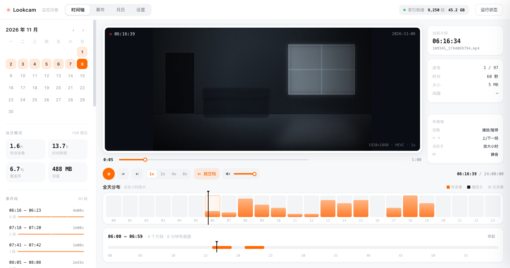

# Lookcam

A timeline for browsing fragmented security-camera footage — the clips your camera pushes to a NAS when it detects motion.

**Not a general-purpose NVR.** It does one thing: help you find those few minutes inside footage that covers only 8% of the day.

English · [简体中文](README.zh-CN.md)



*The video area is a synthetic placeholder, not real footage. Everything else — the UI and the data — comes from a camera that actually runs.*

---

## Why this exists

A consumer camera doesn't record continuously. It records 60 seconds when something moves, then saves one file. One day of mine produced 122 of them:

| Metric | One of my days |
|---|---|
| Time with actual footage | 2.0 hours |
| Span covered | 21.7 hours |
| Share of the day | **8%** |
| Average density | one minute of video every ten minutes |

The gaps aren't evenly distributed either: half are under a minute (continuous recording, chopped up), 40% are over five minutes (nobody home), and the longest was 3.5 hours.

So pointing a file manager at 122 files named `54M50S_1793908490.mp4` tells you nothing about which one has a person in it. This isn't a player — it's a **locator**:

- **Two-tier timeline** — a 24-hour histogram shows which hours had activity; clicking one opens a continuous track for that hour, so you can land on a specific clip
- **Gaps skipped by default** — clips are often tens of minutes apart, so waiting them out in real time is pointless. Turn it off if you want to watch them
- **Event grouping** — consecutive fragments merge into a single "activity", with a threshold of 1/2/5/10 minutes

> One detail that's easy to misread: in `54M50S_1793908490.mp4`, the `54M50S` prefix means *this clip starts at minute 54, second 50 of that hour*. It is **not** a duration. The real duration comes from the mp4 `mvhd` box — about 60 seconds each.

## Features

- **Two-tier timeline** plus a per-clip scrub bar that shows buffered range and is draggable
- **Continuous playback** — a finished clip rolls into the next one, and the end of a day rolls into the next day that has footage
- **Gap handling** — skip instantly, or "wait it out" at the current speed (capped at 20 seconds of wall time)
- **Speed** 1× / 2× / 4× / 8×, **volume slider and mute**, volume remembered locally
- **Keyboard** — `Space` play/pause, `←` `→` previous/next clip, `M` mute
- **Settings page** — scan interval, watch directory, concurrency and more, editable at runtime without restarting the container
- **Small** — zero npm dependencies; the index for 9,250 clips is a 1.1 MB JSON file

## Quick start

You need a NAS that can run Docker, and a footage directory the NAS can read.

**1. Find the real path to your footage**

```bash
ssh <your-nas>
ls /volume1
ls /volume1/Camera/xiaomi_camera_videos
```

You should see a directory named with a long hex string (the device ID, e.g. `a1b2c3d4e5f6`). The path must point at `xiaomi_camera_videos` itself, not its parent.

**2. Set the two paths**

```bash
cp .env.example .env
```

```ini
WATCH_DIR_HOST=/volume1/Camera/xiaomi_camera_videos
DATA_DIR_HOST=/volume1/docker/lookcam
```

**3. Start it**

```bash
docker compose up -d --build
```

**4. Open** `http://<nas-ip>:8420`

The first launch scans everything in the background — the UI stays usable, with progress in the header. A full scan reads the head and tail of every file for its duration: measured at **~75 ms per file over an SMB mount**, so 9,000-odd files works out to **on the order of ten minutes**. Reading the NAS's local disk from inside the container is considerably faster.

> **Which browser?** This footage is almost always H.265 (HEVC). **Safari and Chrome on macOS play it; Firefox does not.** The page probes codec support on load and shows a banner when it's missing, rather than leaving you staring at a black rectangle. See [Codec notes](#codec-notes).

### Rather not build on the NAS?

If your NAS is slow, or can't reach an image registry, build the image somewhere else and ship it over. **The one thing you can't skip: build for the NAS's architecture.**

Most Macs (especially Apple Silicon) are arm64; most NAS boxes are x86_64. An image built for the host architecture will fail on the NAS with `exec format error`.

Check the NAS first:

```bash
ssh <nas> uname -m
# x86_64  → linux/amd64 (most NAS boxes)
# aarch64 → linux/arm64
```

Then, on your machine:

```bash
./build-image.sh                      # defaults to linux/amd64
TARGET=linux/arm64 ./build-image.sh   # if your NAS is ARM
```

The script builds, **verifies the resulting architecture**, and writes `lookcam-linux-amd64.tar.gz`. Then:

```bash
scp lookcam-linux-amd64.tar.gz <nas>:/volume1/docker/
ssh <nas> 'docker load < /volume1/docker/lookcam-linux-amd64.tar.gz'
docker compose up -d --no-build
```

Don't drop `--no-build`: without it, Compose sees the `build:` section and tries to rebuild on the NAS — where there's no source tree, and possibly no network.

Updating later is the same loop: rerun the script → copy → load → up.

> You need a working Docker engine and the buildx plugin locally (Docker Desktop, OrbStack, or colima). Cross-architecture builds run under QEMU emulation, so they're slower than native — and you may need to install binfmt once:
> `docker run --privileged --rm tonistiigi/binfmt --install amd64`

### Publish an image so the NAS can just pull it

Less bookkeeping than shipping a tarball: push to a registry and let the NAS run `docker compose pull`. Two routes:

**A. Let GitHub Actions do it (recommended — no Docker engine needed locally)**

`.github/workflows/docker.yml` is already in the repo. Any push to `main`, a `v*` tag, or a manual run builds **both `linux/amd64` and `linux/arm64`** on GitHub's runners and publishes `ghcr.io/caicaiks/lookcam:latest`. It uses the built-in `GITHUB_TOKEN` with `packages: write`; public repos are free and **no secret needs to be created**.

Check the Actions tab after pushing. Once, after the first build, go to `GitHub → Packages → lookcam → Package settings` and set visibility to **Public**, otherwise the NAS will get `denied` when pulling.

**B. Build and push from your machine**

You need a local Docker engine, buildx, and registry credentials:

```bash
# GHCR, reusing your gh CLI token (needs write:packages)
gh auth refresh -s write:packages
echo "$(gh auth token)" | docker login ghcr.io -u "$(gh api user --jq .login)" --password-stdin
./push-image.sh

# Or push to Docker Hub instead
REGISTRY=docker.io/<your-user> ./push-image.sh
```

> A multi-arch image can't be `--load`ed locally; buildx has to `--push` it directly, so a registry account is unavoidable here. If you only need x86, `PLATFORMS=linux/amd64 ./push-image.sh` is much faster.

**Switch the NAS to pulling**

Add one line to `.env`:

```ini
LOOKCAM_IMAGE=ghcr.io/caicaiks/lookcam:latest
```

```bash
docker compose pull
docker compose up -d --no-build
```

From then on: wait for Actions (or rerun `push-image.sh`), then on the NAS run `docker compose pull && docker compose up -d --no-build`.

---

## Where your footage can live

The scanner makes no assumptions about directory layout. **Time comes from the clip itself, not from where it's stored** — the folder name is just how files are grouped; the real timestamp is in the filename.

Timestamps are resolved in this order, first match wins:

| # | Source | Example |
|---|---|---|
| 1 | 10-digit Unix seconds at the end of the filename | `54M50S_1793908490.mp4` |
| 2 | A calendar timestamp embedded in the filename | `20261108171234.mp4`, `2026-11-08_17-12-34.mp4`, `ch01_20261109100000.mp4` |
| 3 | `YYYYMMDD[HH]` in the directory name, plus an `MMmSSs` filename prefix | `2026081017/03M20S.mp4` |
| 4 | File mtime | names carrying no time at all |

All of these work out of the box, with no configuration:

```
<WATCH_DIR>/<device-id>/YYYYMMDDHH/54M50S_1793908490.mp4   Xiaomi, as-is
<WATCH_DIR>/2026-11-08/2026-11-08_17-12-34.mp4             one folder per day
<WATCH_DIR>/cam/202611/09/ch01_20261109100000.mp4          year / month / day + brand prefix
<WATCH_DIR>/20261108171234.mp4                             completely flat
```

Two behaviours worth knowing:

- **Files that fail all four are skipped, not guessed at.** A scan logs `[scan] 时间来源：文件名 N / 目录 N / mtime N` — but only when a non-filename source was used or something was skipped. If `mtime` shows up in quantity, your filenames carry no time and you should double-check.
- **A clip's day is derived from its own timestamp.** If a file sits in the wrong date folder, the timeline still gets it right.

Directories have exactly one job left: being the **unit of incremental scanning**, so each pass doesn't have to `stat` every file again. How deep to descend is controlled by "scan depth" (default 4).

## Configuration

Configuration has two layers, and the split is deliberate: **`.env` decides how the container comes up; `settings.json` decides how the service runs.**

### Environment-only

| Variable | Default | Why it can't live in the settings page |
|---|---|---|
| `WATCH_DIR_HOST` | required | Docker needs it before creating the mount, when the container doesn't exist yet |
| `DATA_DIR_HOST` | required | Same — and `settings.json` lives inside this directory |
| `WATCH_DIR` | `/media/rec` | The mount point inside the container; it maps 1:1 to a volume, don't touch |
| `DATA_DIR` | `/data` | Same. `settings.json` is already in there, so it can't decide its own location |
| `TZ` | `Asia/Shanghai` | Determines which day each clip lands on. Changing it invalidates the index, so it doesn't belong in a UI you can poke at |

### Everything else lives in the settings page

`settings.json` stores only the values you explicitly changed. It **overrides the environment**, survives restarts, and is safe to hand-edit (`{"scanInterval": 10}`). Each value is validated on load; invalid ones are skipped and logged.

| Group | Editable |
|---|---|
| Monitoring & index | watch directory, device ID, scan depth, scan interval, scan on boot |
| Scan performance | directory concurrency, file concurrency, read real duration, fallback duration |
| Events & thumbnails | event merge threshold, thumbnail cache limit, ffmpeg path |
| Service | port, bind address (**restart required**) |

The UI tells you when each change takes effect:

- **Watch directory / device ID / scan depth / read real duration** → full rescan starts immediately (records for directories that no longer exist are pruned afterwards)
- **Scan interval** → the timer is reset at once; `0` disables automatic scanning
- **Concurrency** → applies on the next scan
- **Port / bind address** → after a service restart

"Reset" next to a row drops the local value and falls back to the environment default; rows tagged "modified" are the overridden ones.

> Putting the port in the settings page has one cost: get it wrong and the service won't start. So a failed bind prints exactly which file to edit instead of just throwing `EADDRINUSE`.

## How it works

- The index lives in `DATA_DIR/index.json`. In memory it's a Map and queries are plain iteration — 20k clips a year is a few MB, so a database would be dead weight
- **First run** scans everything, reading a few dozen KB from the head and tail of each file to get its duration
- **After that** it's incremental: new directories are always scanned; ones whose name says today or yesterday are rescanned; ones with no date in the name (flat layouts, month buckets) are compared by directory mtime; everything else is skipped without even a `stat`
- Durations already probed are reused when the filename and file size are unchanged
- **Full rescan** (the "scan now" button) also prunes records for footage that's gone from disk. It takes minutes, so the endpoint fires and returns, and the UI polls for status
- A corrupt index is backed up as `index.json.bad.<timestamp>` before being rebuilt — never silently discarded

**The footage directory is mounted read-only.** Everything written, thumbnails included, goes to `DATA_DIR`. Your camera's folder is never touched, and the NAS sync job never gets pulled into a loop.

## HTTP API

| Method | Path | Description |
|---|---|---|
| GET | `/api/status` | Index state, storage used, scan progress, runtime info |
| GET | `/api/days` | Every day with footage, plus per-day totals |
| GET | `/api/day?date=20261106&gap=300` | Clips, merged events and stats for one day |
| POST | `/api/scan?full=1` | Trigger a scan, returns when done |
| POST | `/api/scan?full=1&async=1` | Fire and forget, returns `202` immediately |
| GET | `/api/settings` | Editable fields (type/range/value/overridden) plus read-only ones |
| POST | `/api/settings` | `{"scanInterval":10}` — written only if every field validates |
| POST | `/api/settings/reset` | `{"key":"scanInterval"}` — back to the environment default |
| GET | `/api/video?k=<relative-dir>&f=<filename>` | Video stream with `Range` support |
| GET | `/api/thumb?k=<relative-dir>&f=<filename>` | Clip thumbnail (ffmpeg frame grab, disk-cached) |

`k` is the clip's directory relative to `WATCH_DIR` — it may be several levels deep, or empty if the clip sits at the root. `f` is the filename. Both are validated segment by segment, and the resolved absolute path must still fall inside `WATCH_DIR`.

Settings writes are **validated as a batch before anything touches disk**: one invalid field rejects the whole request with `400` and a specific reason (e.g. "扫描间隔 需要在 0 ~ 1440 之间"). You never end up with half-applied settings.

## Local development

No Docker, no `npm install` (zero dependencies), Node ≥ 18:

```bash
cd app
WATCH_DIR=/path/to/xiaomi_camera_videos DATA_DIR=/tmp/lookcam-data node server.js
```

On macOS, if the NAS is already mounted over SMB, just point `WATCH_DIR` at the mount (e.g. `/Volumes/<share>/xiaomi_camera_videos`).

> This is a **local debugging shortcut**. In production the container reads the NAS's local disk directly; the concurrency defaults are tuned for that.

`start-local.sh` in the project root keeps data under `./data` and listens on 8420. **It contains no hardcoded paths** — the watch directory is resolved in this order:

1. `watchDir` from `data/settings.json` (present if you've saved it in the settings page)
2. the `WATCH_DIR` environment variable
3. neither → print usage and exit; it won't guess

```bash
# first run
WATCH_DIR="/your/footage/dir" ./start-local.sh

# afterwards (the path is now in data/settings.json)
./start-local.sh

# different port
PORT=9000 ./start-local.sh
```

### Self-tests

Add a query parameter to run checks in the browser. Results go into a hidden `<pre>`, so headless runners can dump them:

| Parameter | What it does |
|---|---|
| `?selftest=1` | 28 UI-level assertions (index, calendar, timeline, `Range` requests, volume, settings read/write/reset). The title becomes `selftest 28/28` |
| `?videotest=1` | Actually decodes a frame onto a canvas and measures brightness — separates "decoding is broken" from "that moment was genuinely dark" |
| `?debug=1` | Mirrors `video` readyState / currentTime / duration / resolution into the title |

```bash
"/Applications/Google Chrome.app/Contents/MacOS/Google Chrome" \
  --headless=new --no-sandbox --user-data-dir=/tmp/cprof \
  --virtual-time-budget=20000 --dump-dom "http://127.0.0.1:8420/?selftest=1" \
  | grep -o 'selftest [0-9]*/[0-9]*'
```

## Codec notes

The footage is **H.265 / HEVC / Main / Level 5.0 / 8-bit 4:2:0 / 1920×1080** (no `avcC` box, only `hvcC`), and the audio track is **G.711 A-law** (`alaw`, not `mp4a`).

> A gotcha worth recording: I first looked for `mp4a` inside `moov`, concluded there was no audio track, and was wrong. The correct approach is to check `hdlr` for `soun` (is there an audio track at all), then read the `stsd` sample entry 4CC (what codec it uses). All 11 sampled files were `soun` + `alaw`.

That determines which browsers can play it:

| Browser | H.265 video | G.711 audio |
|---|---|---|
| Safari (macOS / iOS) | ✅ hardware decode | ✅ |
| Chrome (macOS) | ✅ via VideoToolbox | ✅ |
| Chrome (Windows) | ⚠️ needs the HEVC Video Extension | ✅ |
| Firefox | ❌ | ❌ |
| Headless Chrome | ❌ no hardware decode, `videoWidth` stays 0 | — |

To confirm audio is actually decoding in Chrome, play a few seconds and check that `video.webkitAudioDecodedByteCount` is above zero (44,160 bytes after 3 seconds in my test). It decodes — which is why the volume slider is a real control, not decoration.

If you ever need to serve clients without H.265, ffmpeg is already in the image and could transcode to H.264 on the fly — at the cost of CPU. Not implemented; add it when there's demand.

## Troubleshooting

**`EACCES` on startup, or the index can't be written**

The container runs as the `node` user (uid 1000). If the bind-mounted host directory belongs to someone else, it can't write:

```bash
chown -R 1000:1000 /volume1/docker/lookcam
```

The first user created on Synology and UGREEN NASes is usually 1000, so most people won't hit this.

**The page loads but the index stays empty**

```bash
docker logs -f lookcam
```

You should see `[scan] 全量：共 N 个目录，需扫 N 个`. If it reports `无法读取 WATCH_DIR`, the `WATCH_DIR_HOST` in `.env` is wrong — it must point at `xiaomi_camera_videos` itself.

**Timestamps are off**

Check the container timezone: `TZ=Asia/Shanghai` in `.env`, and `[boot] 时区 Asia/Shanghai` in the startup log.

**Thumbnails don't appear**

Either ffmpeg is missing from the container or the thumbnail cache is full. Only the `?videotest=1` self-check uses thumbnails; the main UI doesn't depend on them, and playback is unaffected.

**I changed the CSS/JS but the page looks the same**

Static assets are served `no-cache` with an `ETag`, so a normal reload picks up changes (a 304 when nothing changed, costing almost nothing). If it still looks stale, the browser is holding an older copy — hit `Cmd+Shift+R` once.

## Limitations

- **No live view** — history only, no current feed
- **No push notifications** — no motion alerts
- **Chinese-only UI** — strings aren't internationalized yet
- **H.265** — Firefox can't play it; Chrome on Windows needs the HEVC extension
- **Multiple cameras share one timeline** — the index keeps them separate, but the frontend has no camera switcher yet
- **The day timeline isn't draggable** — you navigate by clicking an hour column and then a clip on the track (the per-clip scrub bar *is* draggable)

## License

[MIT](LICENSE)
