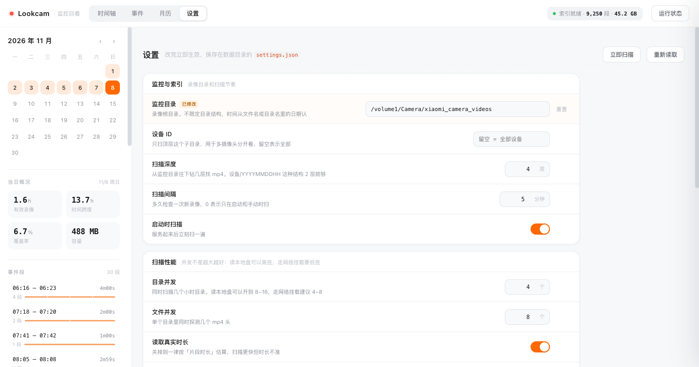

# Lookcam · 监控回看

给小米摄像头录像做的时间轴回看界面。跑在 NAS 的 Docker 里，浏览器打开就能按天、按小时、按事件段翻录像。

> A timeline-based review UI for fragmented security-camera footage. Runs in Docker on your NAS — open a browser and browse by day, hour, or motion event.

不是通用 NVR —— 它只解决一件事：**在覆盖率只有 8% 的碎片录像里，快速定位到那几分钟。**

---

## 它为什么长这样

先说你数据的长相（实测，2026-08 到 2026-11，1,544 个小时目录，45 GB）：

```
<WATCH_DIR>/<设备ID>/YYYYMMDDHH/<分>M<秒>S_<unixts>.mp4
例：a1b2c3d4e5f6/2026110815/01M10S_1794121270.mp4
```

（这只是我这台的布局。扫描器并不要求长这样 —— 见[录像目录怎么放](#录像目录怎么放)。）

三个关键事实，决定了整个产品的形态：

**1. 文件名前缀不是时长。**
`54M50S_1793908490.mp4` 里的 `54M50S` 是「这个片段在 03 点这一小时内，从 54 分 50 秒开始」。真实时长每个都是 **60 秒**，靠读 mp4 头的 `mvhd` 拿（本项目自带解析器，不依赖 ffprobe）。

**2. 60 秒碎片之间不是连续的。**
11 月 6 日：122 个片段、有效画面 2.0 小时，散布在 21.7 小时里，只占全天 8%。平均每 10 分钟才有一分钟有画面。

**3. 空档是双峰的。**
一半空档小于 1 分钟（连续录制被切碎），四成超过 5 分钟（真的没人），最长一段 3.5 小时。所以需要「跳空档」和「事件合并阈值」两个开关，而不是一条匀速播放条。

于是有了：

- **两层时间轴** —— 24 小时柱状概览（看哪个时段有动静）+ 点开某个小时看一整条连续轨道（定位到具体哪一段）
- **单段进度条** —— 视频下方一条可拖拽的进度条，专门对付这 60 秒：定位到第几秒、看还缓存了多少
- **音量与静音** —— 录像带 G.711 音轨，滑块音量按 `M` 静音，设置记在本地
- **默认 1x 原速 + 自动连播** —— 一段播完自动接下一段，空档默认略过（可关掉，改成按倍速「等」过去）；
  当天播完接着下一个有录像的日期，不会停在最后一帧。要快进再点 2x / 4x / 8x
- **事件段聚合** —— 把碎片按间隔合并成「一次活动」，阈值 1/2/5/10 分钟可切
- **设置页** —— 扫描间隔、监控目录、并发数这些在界面上直接改，即时生效，不用重启容器

两层的分工别搞混：**日时间轴负责「找到哪一段」，进度条负责「这一段里第几秒」。**


*（视频区域是合成的示意图，不是真实画面。其余界面与数据来自一台真实运行的摄像头。）*



---

## 部署（任意支持 Docker 的 NAS）

### 1. 确认宿主机路径

SSH 登进 NAS，确认录像目录的真实路径：

```bash
ls /volume1
# 找到放监控的那个卷，然后：
ls /volume1/Camera/xiaomi_camera_videos
```

看到设备 ID 目录（一长串十六进制，比如 `a1b2c3d4e5f6`）就对了。
**`WATCH_DIR_HOST` 要指到 `xiaomi_camera_videos` 这一层**，不是它的上一级。

### 2. 配置

```bash
cp .env.example .env
```

编辑 `.env`，至少改这两行：

```ini
WATCH_DIR_HOST=/volume1/Camera/xiaomi_camera_videos
DATA_DIR_HOST=/volume1/docker/lookcam
```

### 3. 启动

```bash
docker compose up -d --build
```

或者把 `docker-compose.yml` 的内容直接粘进绿联 Docker 的「项目 / Compose」里创建。

### 4. 打开

```
http://<NAS的IP>:8420
```

首次启动会在后台全量扫描。实测 1,544 个目录扫完约 **5 分钟**（这个数字是在 SMB 挂载上测的；容器里直接读 NAS 本地盘会更快）。页面能正常打开，顶栏会显示「扫描中…」，扫完自动刷新。

---

## 录像目录怎么放

上面写的是我这台小米的布局，但**扫描器不要求你长成这样**。

关键点是：**时间来自片段自己，不是目录。** 所以目录只剩下一个职责 —— 当增量扫描的单位，这样每轮不用把所有文件重新 stat 一遍。命名和层级都不限，深度由「扫描深度」控制（默认 4 层）。

时间戳按下面这个顺序认，命中即止：

| 顺序 | 认什么 | 例子 |
|---|---|---|
| 1 | 文件名尾部的 10 位 Unix 秒 | `54M50S_1793908490.mp4` |
| 2 | 文件名里嵌的日历时间 | `20261108171234.mp4`、`2026-11-08_17-12-34.mp4`、`ch01_20261109100000.mp4` |
| 3 | 目录名的 `YYYYMMDD[HH]` + 文件名前缀 `MMmSSs` | `2026081017/03M20S.mp4` |
| 4 | 文件 mtime | 名字里完全不带时间的情况 |

这几种放法都能直接认，不用改配置：

```
<WATCH_DIR>/<设备ID>/YYYYMMDDHH/54M50S_1793908490.mp4   小米原样
<WATCH_DIR>/2026-11-08/2026-11-08_17-12-34.mp4          按天分目录
<WATCH_DIR>/cam/202611/09/ch01_20261109100000.mp4       年 / 月 / 日 + 品牌前缀
<WATCH_DIR>/20261108171234.mp4                          全平铺
```

两条行为值得知道：

- **四层都推不出时间的文件会被跳过，不猜。** 日志里会写一行 `[scan] 时间来源：文件名 N / 目录 N / mtime N`，只有出现非文件名的来源或跳过时才打。日志里如果大量出现 `mtime`，说明你的命名不带时间，建议确认一下 —— 用 mtime 兜底的片段会按文件修改时间归日。
- **归到哪一天只看片段自己的 ts，不看它在哪个目录。** 哪怕某段录像被放进了错的日期目录，时间轴也不会跟着错。

---

## 配置

配置分两层，界线很清楚：**`.env` 管「容器怎么起来」，`settings.json` 管「服务怎么跑」。**
除了下面这四项，其余全部在页面「设置」里改。

### 只能放在环境变量里的

| 变量 | 默认值 | 为什么不能进 settings.json |
|---|---|---|
| `WATCH_DIR_HOST` | 必填 | docker 创建挂载前就得知道，那时候容器还没起来 |
| `DATA_DIR_HOST` | 必填 | 同上；而且 `settings.json` 就住在这个目录里 |
| `WATCH_DIR` | `/media/rec` | 容器内的挂载点，和 volumes 一一对应，不要改 |
| `DATA_DIR` | `/data` | 同上。`settings.json` 已在其中，没法自己决定自己放哪 |
| `TZ` | `Asia/Shanghai` | 决定每条录像归到哪一天。改了要重建索引，不适合放页面里随手改 |

`PORT` 也还认，但只作为**默认值**：设置页里改过就以那边为准。

### 其余都在「设置」页

`settings.json` 存的是用户显式改过的项，**优先级高于环境变量**，重启不丢。手写也行，格式就是 `{"scanInterval": 10}`，启动时逐项校验，非法值跳过并打日志。

| 分类 | 可改项 |
|---|---|
| 监控与索引 | 监控目录、设备 ID、扫描间隔、扫描深度、启动时扫描 |
| 扫描性能 | 目录并发、文件并发、读取真实时长、片段时长 |
| 事件与缩略图 | 事件合并阈值、缩略图缓存上限、ffmpeg 路径 |
| 服务 | 端口、监听地址（**改完要重启**） |

改动什么时候生效，界面上会直接说，不用猜：

- 改**监控目录 / 设备 ID / 扫描深度 / 读取真实时长** → 立刻触发全量重扫（旧目录记录会在扫完后清掉）
- 改**扫描间隔** → 立即重设定时器，`0` 就是关掉自动扫描
- 改**并发数** → 下次扫描生效
- 改**端口 / 监听地址** → 重启服务生效
- 其余项下一次读取就生效

每项旁边的「重置」会删掉本地值，回到环境变量给的默认值；带「已修改」标记的就是被覆盖过的项。

> 端口放在设置里有个代价：填错了服务会起不来。所以绑定失败时日志会直接告诉你改哪个文件，不会只抛一个 `EADDRINUSE`。

---

## 索引与扫描

- 索引落在 `DATA_DIR/index.json`，内存里是 Map，查询是纯遍历 —— 一年两万多条也就几 MB，没必要上数据库
- **首次**：全量扫所有目录，每个文件读头尾各几十 KB 拿时长
- **之后**：每 5 分钟只重扫「今天 + 昨天」的目录，以及新出现的目录；已探测过的时长按「文件名 + 文件大小」复用，不会重复读
- **全量重扫**（设置页的「立即扫描」，或「运行状态」抽屉里）：会顺带清掉磁盘上已经消失的录像记录。这个动作要几分钟，所以走的是「点火即返回 + 轮询状态」，不会把请求吊在那里
- 索引损坏会先备份成 `index.json.bad.<时间戳>` 再重建，不会静默丢数据

**容器对录像目录是只读挂载**，包括缩略图在内的一切写入都落在 `DATA_DIR`，不会碰你的监控目录，也不会触发同步任务的循环。

---

## API

| 方法 | 路径 | 说明 |
|---|---|---|
| GET | `/api/status` | 索引状态、容量、扫描进度、运行环境 |
| GET | `/api/days` | 所有有录像的日期及每天汇总 |
| GET | `/api/day?date=20261106&gap=300` | 当天片段列表 + 事件段 + 统计 |
| POST | `/api/scan?full=1` | 触发扫描（`full=1` 全量），同步返回结果 |
| POST | `/api/scan?full=1&async=1` | 只点火不等结果，立刻返回 `202` |
| GET | `/api/settings` | 可改项（含类型/范围/当前值/是否被覆盖）+ 只读项 |
| POST | `/api/settings` | `{"scanInterval":10}`，全部校验通过才落盘，返回最新全量配置 |
| POST | `/api/settings/reset` | `{"key":"scanInterval"}`，恢复为环境变量默认值 |
| GET | `/api/video?d=&k=&f=` | 视频流，支持 `Range`，可拖动 |
| GET | `/api/thumb?d=&k=&f=` | 片段缩略图（ffmpeg 抽帧，磁盘缓存） |

设置接口是**先全量校验再落盘**：一次提交里只要有一项非法，整批都不生效，返回 `400` 和具体原因（例如「扫描间隔 需要在 0 ~ 1440 之间」），不会出现改了一半的中间状态。

`d` = 设备 ID，`k` = `YYYYMMDDHH`，`f` = 文件名。三段都有严格字符校验，且拼出来的路径必须在 `WATCH_DIR` 之内。

---

## 本地开发

不需要 Docker，也不需要 `npm install`（零依赖）：

```bash
cd app
WATCH_DIR=/path/to/xiaomi_camera_videos DATA_DIR=/tmp/lookcam-data node server.js
```

macOS 上如果 NAS 已经通过 SMB 挂载，把 `WATCH_DIR` 指到挂载点就行（比如 `/Volumes/你的共享名/xiaomi_camera_videos`）。

> 注意这只是**本地调试的取巧办法**。正式部署时容器直接读 NAS 上的本地目录，不经过 SMB —— 目录并发、扫描速度这些参数都是按本地盘给的参考值。

项目根目录有个 `start-local.sh`，把数据落在 `./data`，然后起在 8420。**它不含任何预设路径**，监控目录按下面的顺序找：

1. `data/settings.json` 里的 `watchDir`（在「设置」页保存过就有）
2. 环境变量 `WATCH_DIR`
3. 都没有 → 打印用法后退出，不去猜

所以第一次跑要带一次路径，之后在设置页里改就行：

```bash
# 第一次
WATCH_DIR="/你的/录像目录" ./start-local.sh

# 之后（路径已经从设置页存进 data/settings.json）
./start-local.sh

# 临时换端口
PORT=9000 ./start-local.sh
```

扫描间隔、并发数这些也不再由这个脚本写死，统一在页面「设置」里调，改完即时生效。

本机没装 `ffmpeg` 也能跑：`/api/thumb` 会返回 404，但**前端没有用到这个接口**，时间轴和回放完全不受影响。Docker 镜像里已经内置 ffmpeg。

### 两个自测入口

页面加参数就能跑自检，结果写在隐藏的 `<pre>` 里，适合无头浏览器 dump：

| 参数 | 干什么 |
| --- | --- |
| `?selftest=1` | 跑 28 项界面链路断言（索引、日历、时间轴、Range 请求、音量、设置页读写与重置等），标题会变成 `selftest 28/28` |
| `?videotest=1` | 真的解一帧画到 canvas 上算亮度，用来区分「解码坏了」和「那一刻本来就暗」 |
| `?debug=1` | 把 `video` 的 readyState/currentTime/duration/分辨率实时打到标题上 |

```bash
"/Applications/Google Chrome.app/Contents/MacOS/Google Chrome" \
  --headless=new --no-sandbox --disable-gpu --user-data-dir=/tmp/cprof \
  --virtual-time-budget=20000 --dump-dom "http://127.0.0.1:8420/?selftest=1" \
  | grep -o 'selftest [0-9]*/[0-9]*'
```

注意：**无头 Chrome 解不了 H.265**（见下节），所以 `videotest` 在无头下必然测出全黑；要测真实画面必须去掉 `--headless` 和 `--disable-gpu`。

---

## 编码：这批录像是 H.265 + G.711，不是 H.264 + AAC

**视频**：实测 `avcC` 不存在，只有 `hvcC` —— **HEVC / Main profile / Level 5.0 / 8bit 4:2:0 / 1920×1080**。

**音频**：有音轨，但采样条目是 `alaw` 不是 `mp4a` —— **G.711 A-law，8bit，IP 摄像头常用的电话语音编码**。

顺带记一笔踩坑：一开始只在 moov 里找 `mp4a`，没找到就判定「无音轨」，是错的。正确做法是找 `hdlr` 里的 `soun`（判断有没有音轨），再看 `stsd` 的 sample entry 4CC（判断用什么编码）。11 个抽样文件全部是 `soun` + `alaw`。

这直接决定了「用什么浏览器看」：

| 浏览器 | H.265 视频 | G.711 音频 |
| --- | --- | --- |
| Safari（macOS / iOS） | ✅ 系统硬解 | ✅ |
| Chrome（macOS） | ✅ 走 VideoToolbox | ✅ 实测能解 |
| Chrome（Windows） | ⚠️ 需装 HEVC 视频扩展 | ✅ |
| Firefox | ❌ | ❌ |
| 无头 Chrome | ❌ 拿不到硬解，`videoWidth` 恒为 0 | — |

音频能不能解，可以用这个字段确认（Chrome）：播放几秒后 `video.webkitAudioDecodedByteCount` 应大于 0，实测 3 秒解出 44160 字节。因为能解，音量条才是真能用的功能，不是摆设。

所以页面开头加了能力检测：`canPlayType('video/mp4; codecs="hvc1..."')` 为空就顶一条橙色提示条，直接告诉你换 Safari 或 Chrome，而不是让你对着黑屏猜。

验证方法（不带 `--disable-gpu`）：

```js
const v = document.createElement('video');
v.canPlayType('video/mp4; codecs="hvc1.1.6.L150.90"'); // "probably" = 能播
```

如果以后要在不支持 H.265 的客户端上看，可以在容器里用 ffmpeg 转码成 H.264 再吐流（镜像里已有 ffmpeg），代价是吃 CPU —— 目前没做，按需再加。

---

## 常见问题

**启动后报 `EACCES` 或索引写不进去**

容器里的进程是 `node` 用户（uid 1000），bind mount 的宿主机目录如果属主不同就写不了。在 NAS 上执行：

```bash
chown -R 1000:1000 /volume1/docker/lookcam
```

群晖和绿联的第一个创建的用户通常就是 1000，一般不会遇到这个问题。

**页面打得开，但索引一直是空的**

看容器日志：

```bash
docker logs -f lookcam
```

正常会看到 `[scan] 全量：共 N 个目录，需扫 N 个`。如果直接报 `无法读取 WATCH_DIR`，说明 `.env` 里的 `WATCH_DIR_HOST` 路径不对 —— 它要指到 `xiaomi_camera_videos` 这一层。

**时间对不上**

容器时区。确认 `.env` 里 `TZ=Asia/Shanghai`，且启动日志里 `[boot] 时区 Asia/Shanghai`。

**缩略图不显示**

容器里 `ffmpeg` 没装上，或者 `THUMB_CACHE_MAX_MB` 已经写满。缩略图只是悬停预览用，不影响回放。

**改了样式 / 脚本，刷新却没变化**

静态资源用 `no-cache` + `ETag`，正常刷新就会拿到最新的（未变更是 304，几乎不耗流量）。如果界面还是旧样子，多半是浏览器里留着更早版本的缓存 —— 按一次 `Cmd+Shift+R` 强制刷新。

---

## 已知限制

- **没有实时预览** —— 只看历史录像，不看当前画面
- **没有推送** —— 不做移动侦测通知
- **H.265 编码** —— Firefox 放不出来，Windows 的 Chrome 要装 HEVC 扩展；Safari 和 macOS 上的 Chrome 正常
- 只支持小米这套 `MMmSSs_<ts>.mp4` 命名；别的摄像头要改 `lib/scanner.js` 里的 `SEG_NAME`
- 多设备会全部混在一个时间轴里（索引里已按设备分开存，前端还没做切换）
- 全天那条时间轴还不支持直接拖拽播放头，靠点柱子 + 点分钟格定位（单段进度条已可拖）
