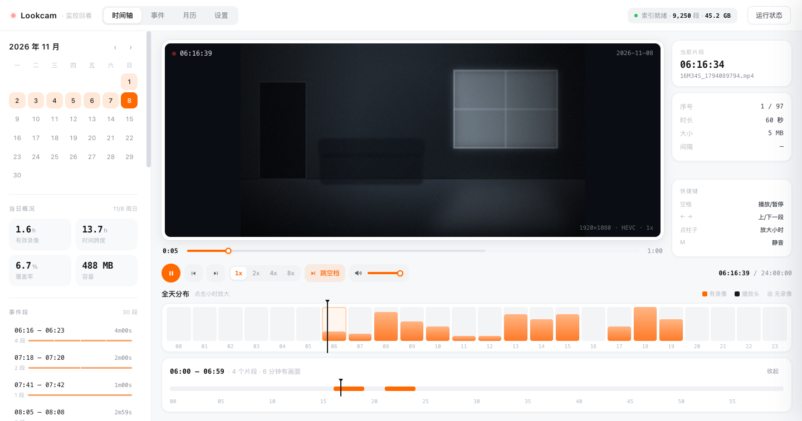

# Lookcam

把摄像头同步到 NAS 的碎片录像，做成一条能按时间翻的时间轴。

**不是通用 NVR。** 它只解决一件事：在覆盖率只有 8% 的碎片录像里，快速找到那几分钟。

[English](README.md) · 简体中文



*（视频区域是合成的示意图，不含真实画面；界面与数据来自一台真实运行的米家摄像头。）*

---

## 为什么需要它

家用摄像头不是一直在录。画面有变化才录 60 秒，存成一个文件。我某一天存了 122 个：

| 项目 | 我这一天 |
|---|---|
| 有画面的时间 | 2.0 小时 |
| 最早到最晚的跨度 | 21.7 小时 |
| 占全天 | **8%** |
| 平均密度 | 每 10 分钟才有一分钟有画面 |

而且空档不是均匀的 —— 一半不到 1 分钟（连续录制被切碎），四成超过 5 分钟（真的没人），最长一段 3.5 小时。

打开文件管理器，面对 122 个叫 `54M50S_1793908490.mp4` 的文件，你没法知道哪一段里有人。所以这里做的不是播放器，是**定位器**：

- **两层时间轴** —— 24 小时柱状图看哪个时段有动静，点进某个小时看一条连续轨道，定位到具体哪一段
- **默认跳过空档** —— 60 秒之间常常隔着几十分钟，按真实时间等没有意义。想看空档可以关掉这个开关
- **事件段聚合** —— 把连续的碎片合并成「一次活动」，阈值 1/2/5/10 分钟可切

> 顺带记一个容易读错的细节：`54M50S_1793908490.mp4` 里的 `54M50S` 是「这一段在该小时内从第 54 分 50 秒开始」，**不是时长**。真实时长是读 mp4 头的 `mvhd` 拿的，每个都约 60 秒。

## 能做什么

- **两层时间轴** + 单段进度条（显示已缓冲范围，可拖动）
- **自动连播** —— 一段播完接下一段，当天播完接下一个有录像的日期
- **空档处理** —— 一键跳过，或按当前倍速「等」过去（最多等 20 秒真实时间）
- **倍速** 1× / 2× / 4× / 8×，**音量滑块 + 静音**，默认音量记在本地
- **键盘** —— `空格` 播放/暂停，`←` `→` 上/下一段，`M` 静音
- **设置页** —— 扫描间隔、监控目录、并发数这些在界面上改，即时生效，不用重启容器
- **轻量** —— 零 npm 依赖，9,250 段录像的索引是一个 1.1 MB 的 JSON

## 快速开始

需要一台能跑 Docker 的 NAS，以及 NAS 上能读到的录像目录。

**1. 找到录像目录的真实路径**

```bash
ssh <你的 NAS>
ls /volume1
ls /volume1/Camera/xiaomi_camera_videos
```

看到一长串十六进制目录（设备 ID，比如 `a1b2c3d4e5f6`）就对了。路径要指到 `xiaomi_camera_videos` 这一层，不是它的上一级。

**2. 配置两个路径**

```bash
cp .env.example .env
```

```ini
WATCH_DIR_HOST=/volume1/Camera/xiaomi_camera_videos
DATA_DIR_HOST=/volume1/docker/lookcam
```

**3. 启动**

```bash
docker compose up -d --build
```

**4. 打开** `http://<NAS的IP>:8420`

首次启动会在后台全量扫描，期间页面照常可用，顶栏显示「扫描中…」。全量扫描要给每个文件读一次头尾拿时长，实测在 SMB 挂载上**单文件约 75 ms**，9,000 多个文件大致是**十分钟量级**；容器直接读 NAS 本地盘会快不少。

> **用什么浏览器看** —— 这类录像基本是 H.265（HEVC）编码，**Safari 和 macOS 上的 Chrome 能直接放，Firefox 放不了**。页面会先做能力检测，不支持时顶一条提示条，不会让你对着黑屏猜。详见下文[编码](#编码-h265-与-g711)一节。

### 最省事：只拷两个文件到 NAS（推荐）

根目录的 `docker-compose.yml` 带 `build: ./app`，要在 NAS 上放整套源码现场编译。
只是想用的话不必如此：[`nas/docker-compose.yml`](nas/docker-compose.yml) +
[`nas/.env.example`](nas/.env.example) 两个文件就够了，镜像直接从 GHCR 拉，NAS 上不用装 Node。

```bash
# 在 NAS 上
mkdir -p /volume1/docker/lookcam && cd /volume1/docker/lookcam
# 把上面两个文件拷进来，.env.example 改名 .env，填两个路径
docker compose pull
docker compose up -d
```

镜像是 `linux/amd64` + `linux/arm64` 双架构，Docker 会按 NAS 的 CPU 自动选，不用手动指定平台。
`.env` 里必填的只有 `WATCH_DIR_HOST`（录像目录）和 `DATA_DIR_HOST`（索引存放处），
端口、时区、镜像标签都是可选项。

NAS 上几个容易踩的坑：

- **别把电脑上的 `data/` 目录拷过去** —— 里面的 `settings.json` 记着本机调试用的挂载路径，会让 NAS 扫不到录像。数据目录留空，首次启动会自己建索引。
- **默认以 root（`0:0`）运行**。镜像自带的 `node` 用户是 uid 1000，而 NAS 共享文件夹的属主通常不是 1000、父目录还常是 700，用 1000 跑会在扫描时报 `EACCES: permission denied, scandir '/media/rec'`。录像目录是 `:ro` 挂载，容器改不了它。想收紧权限：在 NAS 上 `ls -ln <录像目录>` 查出属主数字，把 `.env` 的 `PUID` / `PGID` 填成它，并 `chown -R <PUID>:<PGID> <DATA_DIR_HOST>` 保证数据目录可写。
- 在群晖 Container Manager / 绿联 / 威联通的图形界面里粘贴时，界面通常不读 `.env`，要把两处 `${...}` 换成实际路径；替换清单写在文件头部注释里。
- 拉不动 `ghcr.io` 时，用 `build-image.sh` 导出 tar.gz 传上去 `docker load`，再把 `.env` 的 `LOOKCAM_IMAGE` 改成本地镜像名。

### 不想在 NAS 上构建？本机打好再传上去

NAS 性能弱、或者拉不动镜像仓库时，可以在本机构建、导出、再传上去。
**只有一步不能省：必须按 NAS 的架构构建。**

Mac（尤其 Apple Silicon）是 arm64，绝大多数 NAS 是 x86_64。按本机架构打出来的镜像拷过去，启动时会直接 `exec format error`。

先在 NAS 上确认：

```bash
ssh <nas> uname -m
# x86_64  → linux/amd64（大多数 NAS）
# aarch64 → linux/arm64
```

然后在本机：

```bash
./build-image.sh                      # 默认 linux/amd64
TARGET=linux/arm64 ./build-image.sh   # NAS 是 ARM 的话
```

脚本会构建、**核对产物架构**、导出成 `lookcam-linux-amd64.tar.gz`。接着：

```bash
scp lookcam-linux-amd64.tar.gz <nas>:/volume1/docker/
ssh <nas> 'docker load < /volume1/docker/lookcam-linux-amd64.tar.gz'
docker compose up -d --no-build
```

`--no-build` 别省：不加的话 compose 看到 `build:` 段落会尝试在 NAS 上重新构建，而 NAS 上既没有源码，也不一定有网络。

以后更新代码就是「重跑脚本 → 传 → load → up」。

> 本机需要有可用的 Docker 引擎和 buildx 插件（Docker Desktop / OrbStack / colima 任一）。跨架构构建走 QEMU 模拟，会比原生慢，第一次还可能要先装 binfmt：
> `docker run --privileged --rm tonistiigi/binfmt --install amd64`

### 发布到镜像仓库，让 NAS 直接 pull

比传 tar 更省事：镜像推到仓库，NAS 上 `docker compose pull` 就能更新。两条路：

**A. 交给 GitHub Actions（推荐，本机完全不用装 Docker）**

仓库里已有 `.github/workflows/docker.yml`。每次 push 到 `main`、打 `v*` 标签，或手动触发，都会在 GitHub 的机器上构建 **`linux/amd64` + `linux/arm64` 双架构**镜像，推到 `ghcr.io/caicaiks/lookcam:latest`。用的是内置的 `GITHUB_TOKEN` 和 `packages: write` 权限，公开仓库免费，**不用申请任何密钥**。

推完到 Actions 页看构建结果。公开仓库用 `GITHUB_TOKEN` 推上去的包会继承仓库可见性（实测匿名拉取返回 200），一般不用额外设置；万一 NAS 拉取报 `denied`，再去 `GitHub → Packages → lookcam → Package settings` 把可见性改成 **Public**。

**B. 本机构建并推送**

需要本机有 Docker 引擎、buildx，以及仓库登录凭证：

```bash
# GHCR：用 gh 的凭证（需要 write:packages 权限）
gh auth refresh -s write:packages
echo "$(gh auth token)" | docker login ghcr.io -u "$(gh api user --jq .login)" --password-stdin
./push-image.sh

# 或推到 Docker Hub
REGISTRY=docker.io/<你的用户名> ./push-image.sh
```

> 多架构镜像没法 `--load` 到本地，只能构建完直接 `--push`，所以这一步绕不开仓库账号。只出 x86 的话用 `PLATFORMS=linux/amd64 ./push-image.sh`，会快很多。

**NAS 上改用拉取**

`.env` 里加一行：

```ini
LOOKCAM_IMAGE=ghcr.io/caicaiks/lookcam:latest
```

```bash
docker compose pull
docker compose up -d --no-build
```

以后更新：等 Actions 跑完（或重跑 `push-image.sh`）→ NAS 上 `docker compose pull && docker compose up -d --no-build`。

---

## 录像放哪都行

扫描器不假设目录结构。**时间来自片段自己，不是来自它放在哪个目录** —— 目录名只是存放位置的划分，真正的时间戳在文件名里。

推时间戳按这个顺序，命中即止：

| 顺序 | 依据 | 例子 |
|---|---|---|
| 1 | 文件名尾部的 10 位 Unix 秒 | `54M50S_1793908490.mp4` |
| 2 | 文件名里嵌的日历时间 | `20261108171234.mp4`、`2026-11-08_17-12-34.mp4`、`ch01_20261109100000.mp4` |
| 3 | 目录名的 `YYYYMMDD[HH]` + 文件名前缀 `MMmSSs` | `2026081017/03M20S.mp4` |
| 4 | 文件 mtime | 名字里完全不带时间的情况 |

下面这些放法都能直接认，不用改任何配置：

```
<WATCH_DIR>/<设备ID>/YYYYMMDDHH/54M50S_1793908490.mp4   米家原样
<WATCH_DIR>/2026-11-08/2026-11-08_17-12-34.mp4          按天分目录
<WATCH_DIR>/cam/202611/09/ch01_20261109100000.mp4       年 / 月 / 日 + 品牌前缀
<WATCH_DIR>/20261108171234.mp4                          全平铺
```

两条行为值得知道：

- **四级都推不出时间的文件会被跳过，不猜。** 日志里会打一行 `[scan] 时间来源：文件名 N / 目录 N / mtime N`（只在出现非文件名的来源或跳过时才打）。如果日志里大量出现 `mtime`，说明你的命名不带时间，建议确认一下。
- **归到哪一天只看片段自己的时间戳。** 哪怕某段录像被放进了错的日期目录，时间轴也不会跟着错。

目录唯一的作用是当**增量扫描的单位** —— 这样每轮不用把所有文件重新 `stat` 一遍。往下找几层由「扫描深度」控制，默认 4 层。

## 配置

配置分两层，界线很清楚：**`.env` 管「容器怎么起来」，`settings.json` 管「服务怎么跑」。**

### 只能在环境变量里定的

| 变量 | 默认值 | 为什么不能进设置页 |
|---|---|---|
| `WATCH_DIR_HOST` | 必填 | Docker 创建挂载前就得知道，那时候容器还没起来 |
| `DATA_DIR_HOST` | 必填 | 同上；而且 `settings.json` 就住在这个目录里 |
| `WATCH_DIR` | `/media/rec` | 容器内的挂载点，和 volumes 一一对应，别改 |
| `DATA_DIR` | `/data` | 同上。`settings.json` 已在其中，没法自己决定自己放哪 |
| `TZ` | `Asia/Shanghai` | 决定每条录像归到哪一天。改了要重建索引，不适合页面里随手改 |

### 其余都在设置页

`settings.json` 只存你显式改过的项，**优先级高于环境变量**，重启不丢。手写也行，格式是 `{"scanInterval": 10}`，启动时逐项校验，非法值跳过并打日志。

| 分类 | 可改项 |
|---|---|
| 监控与索引 | 监控目录、设备 ID、扫描深度、扫描间隔、启动时扫描 |
| 扫描性能 | 目录并发、文件并发、读取真实时长、片段时长 |
| 事件与缩略图 | 事件合并阈值、缩略图缓存上限、ffmpeg 路径 |
| 服务 | 端口、监听地址（**改完要重启**） |

改完什么时候生效，界面上会直接写出来：

- **监控目录 / 设备 ID / 扫描深度 / 读取真实时长** → 立刻全量重扫（已消失的目录记录会在扫完后清掉）
- **扫描间隔** → 立即重设定时器，设 `0` 就是关掉自动扫描
- **并发数** → 下次扫描生效
- **端口 / 监听地址** → 重启服务生效

每项旁边的「重置」删掉本地值，回到环境变量给的默认值；带「已修改」标记的就是被覆盖过的项。

> 端口放进设置页有个代价：填错了服务会起不来。所以绑定失败时日志会直接告诉你该改哪个文件，不会只抛一个 `EADDRINUSE`。

## 工作原理

- **索引**落在 `DATA_DIR/index.json`，内存里是 Map，查询是纯遍历。一年两万多条也就几 MB，没必要上数据库
- **首次**全量扫描，每个文件读头尾各几十 KB 拿时长
- **之后**增量：新目录必扫；今天/昨天的目录每轮重扫；其余目录比对「文件名列表指纹」。指纹是 `readdir` 顺手算的，不额外 `stat`，所以走网络挂载也只要零点几秒
- 已探测过的时长按「文件名 + 文件大小」复用，不会重复读
- **录像过期被删除时索引会跟着清**：每轮扫描都会复核「索引里有、但这次没扫到」的目录，确认目录真的没了、或里面的 mp4 被删光了才移除；只是暂时读不到（权限抖动、网络断连）会保留，不会被误删。目录里只删了一部分文件则由指纹变化感知
- 另外**每 24 小时自动做一次全量扫描**兜底，补上极少数漏网情况。设置页的「立即扫描」也是全量，接口是「点火即返回 + 轮询状态」，不会把请求吊在那里
- 索引损坏会先备份成 `index.json.bad.<时间戳>` 再重建，不会静默丢数据

**容器对录像目录是只读挂载。** 包括缩略图在内的一切写入都落在 `DATA_DIR`，不会碰你的监控目录，也不会把 NAS 的同步任务带进循环。

## HTTP 接口

| 方法 | 路径 | 说明 |
|---|---|---|
| GET | `/api/status` | 索引状态、容量、扫描进度、运行环境 |
| GET | `/api/days` | 所有有录像的日期及每天汇总 |
| GET | `/api/day?date=20261106&gap=300` | 当天片段列表 + 事件段 + 统计 |
| POST | `/api/scan?full=1` | 触发扫描，同步返回结果 |
| POST | `/api/scan?full=1&async=1` | 只点火不等结果，立刻返回 `202` |
| GET | `/api/settings` | 可改项（类型/范围/当前值/是否被覆盖）+ 只读项 |
| POST | `/api/settings` | `{"scanInterval":10}`，全部校验通过才落盘 |
| POST | `/api/settings/reset` | `{"key":"scanInterval"}`，恢复为环境变量默认值 |
| GET | `/api/video?k=<相对目录>&f=<文件名>` | 视频流，支持 `Range` |
| GET | `/api/thumb?k=<相对目录>&f=<文件名>` | 片段缩略图（ffmpeg 抽帧 + 磁盘缓存） |

`k` 是片段所在目录相对于 `WATCH_DIR` 的路径，可以多级，也可以是空串（片段就在根目录）；`f` 是文件名。两者都逐段校验，并且拼出来的绝对路径必须还在 `WATCH_DIR` 之内。

设置接口是**先全量校验再落盘**：一次提交里只要有一项非法，整批都不生效，返回 `400` 和具体原因（例如「扫描间隔 需要在 0 ~ 1440 之间」），不会出现改了一半的中间状态。

## 本地开发

不需要 Docker，也不需要 `npm install`（零依赖），Node ≥ 18 即可：

```bash
cd app
WATCH_DIR=/path/to/xiaomi_camera_videos DATA_DIR=/tmp/lookcam-data node server.js
```

macOS 上如果 NAS 已通过 SMB 挂载，把 `WATCH_DIR` 指到挂载点就行（比如 `/Volumes/你的共享名/xiaomi_camera_videos`）。

> 这只是**本地调试的取巧办法**。正式部署时容器直接读 NAS 本地目录，不经过 SMB —— 并发数那些默认值是按本地盘给的参考值。

项目根目录的 `start-local.sh` 把数据落在 `./data`，起在 8420。**它不含任何预设路径**，监控目录按这个顺序找：

1. `data/settings.json` 里的 `watchDir`（在设置页保存过就有）
2. 环境变量 `WATCH_DIR`
3. 都没有 → 打印用法后退出，不去猜

```bash
# 第一次
WATCH_DIR="/你的/录像目录" ./start-local.sh

# 之后（路径已存进 data/settings.json）
./start-local.sh

# 临时换端口
PORT=9000 ./start-local.sh
```

### 自测入口

页面加参数就能跑自检，结果写在隐藏的 `<pre>` 里，适合无头浏览器 dump：

| 参数 | 作用 |
|---|---|
| `?selftest=1` | 跑 34 项界面链路断言（索引、日历、时间轴、Range 请求、音量、设置页读写与重置、选日期后点播放），标题变成 `selftest 34/34` |
| `?videotest=1` | 真解一帧画到 canvas 上算亮度，区分「解码坏了」和「那一刻本来就暗」 |
| `?debug=1` | 把 `video` 的 readyState / currentTime / duration / 分辨率实时打到标题上 |

服务端的索引清理逻辑另有独立回归测试，只用系统临时目录和假文件，不碰真实录像：

```bash
node test/prune.js
```

覆盖：整目录过期删除、目录内删部分文件、权限抖动不误删、落盘与重启一致、旧索引升级无需全量重扫。

```bash
"/Applications/Google Chrome.app/Contents/MacOS/Google Chrome" \
  --headless=new --no-sandbox --user-data-dir=/tmp/cprof \
  --virtual-time-budget=20000 --dump-dom "http://127.0.0.1:8420/?selftest=1" \
  | grep -o 'selftest [0-9]*/[0-9]*'
```

## 编码 H.265 与 G.711

这批录像是 **HEVC / Main / Level 5.0 / 8bit 4:2:0 / 1920×1080**（实测没有 `avcC`，只有 `hvcC`），音轨是 **G.711 A-law**（`alaw`，不是 `mp4a`）。

> 踩坑记录：一开始只在 `moov` 里找 `mp4a`，没找到就判定「无音轨」，是错的。正确做法是先看 `hdlr` 里有没有 `soun`（判断有没有音轨），再看 `stsd` 的 sample entry 4CC（判断用什么编码）。抽样的 11 个文件全部是 `soun` + `alaw`。

这直接决定了能用什么浏览器看：

| 浏览器 | H.265 视频 | G.711 音频 |
|---|---|---|
| Safari（macOS / iOS） | ✅ 系统硬解 | ✅ |
| Chrome（macOS） | ✅ 走 VideoToolbox | ✅ |
| Chrome（Windows） | ⚠️ 需装 HEVC 视频扩展 | ✅ |
| Firefox | ❌ | ❌ |
| 无头 Chrome | ❌ 拿不到硬解，`videoWidth` 恒为 0 | — |

音频是否真的解出来了，可以在 Chrome 里播放几秒后看 `video.webkitAudioDecodedByteCount` 是否大于 0（实测 3 秒解出 44160 字节）—— 能解，所以音量条不是摆设。

如果以后要在不支持 H.265 的客户端上看，可以在容器里用 ffmpeg 转成 H.264 再吐流（镜像里已有 ffmpeg），代价是吃 CPU。目前没做，按需再加。

## 常见问题

**启动后报 `EACCES`，索引写不进去**

容器里的进程是 `node` 用户（uid 1000），bind mount 的宿主机目录属主不同就写不了：

```bash
chown -R 1000:1000 /volume1/docker/lookcam
```

群晖和绿联的第一个用户通常就是 1000，一般不会遇到。

**页面打得开，但索引一直是空的**

```bash
docker logs -f lookcam
```

正常会看到 `[scan] 全量：共 N 个目录，需扫 N 个`。如果直接报 `无法读取 WATCH_DIR`，说明 `.env` 里的 `WATCH_DIR_HOST` 不对 —— 它要指到 `xiaomi_camera_videos` 这一层。

**时间对不上**

查容器时区：确认 `.env` 里 `TZ=Asia/Shanghai`，且启动日志里有 `[boot] 时区 Asia/Shanghai`。

**缩略图不显示**

容器里没装 ffmpeg，或者缩略图缓存（`缩略图缓存上限`）已写满。缩略图只有 `?videotest=1` 自检会用到，界面本身不依赖它，不影响回放。

**改了样式或脚本，刷新却没变化**

静态资源用 `no-cache` + `ETag`，正常刷新就能拿到最新（未变更是 304，几乎不耗流量）。如果还是旧样子，多半是浏览器里留着更早的缓存，按一次 `Cmd+Shift+R` 强制刷新。

## 限制

- **没有实时预览** —— 只看历史录像，不看当前画面
- **没有推送** —— 不做移动侦测通知
- **界面只有中文** —— 文案还没做多语言
- **H.265 编码** —— Firefox 放不了，Windows 上的 Chrome 要装 HEVC 扩展
- **多设备会混在一条时间轴里** —— 索引里已按设备分开存，前端还没做切换
- **日时间轴不支持直接拖播放头** —— 靠点小时柱 + 点轨道定位（单段进度条可以拖）

## 许可

[MIT](LICENSE)
